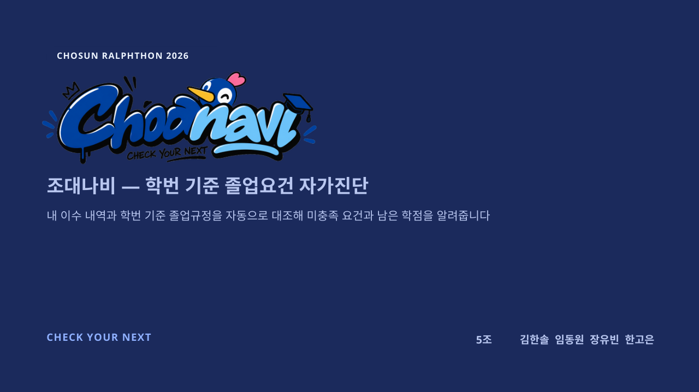
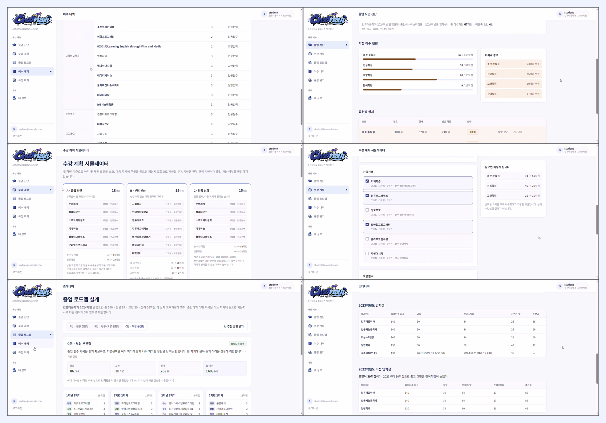
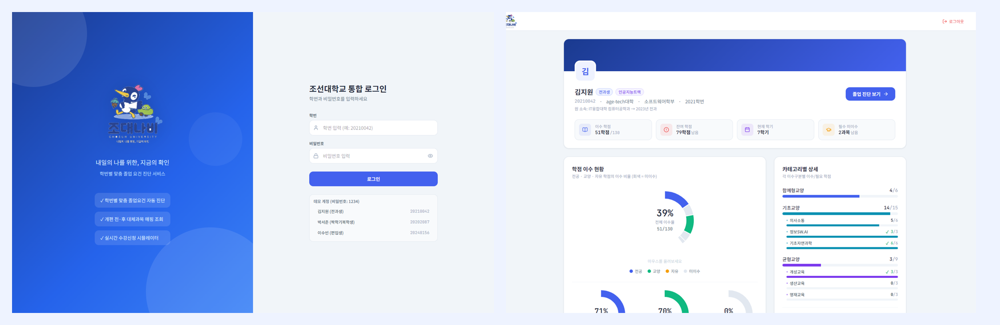
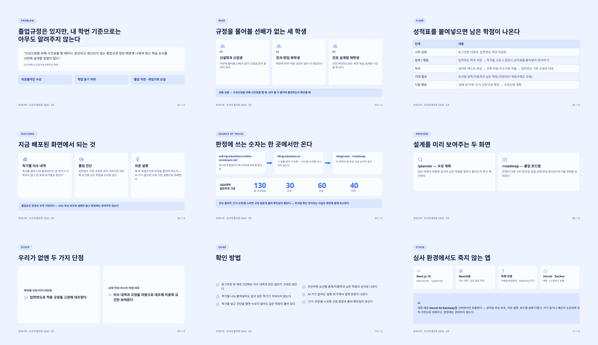

# 조대나비 (Choanavi) — Check Your Next

**학번 기준 졸업요건 자가진단 서비스**

🏅 **2026 SW멤버십 추계 캠프 · 랄프루프톤 장려상**
조선대학교 SW중심대학사업단 × 코드트리 · 2026.09.18 – 09.19 (무박 2일)

[🔗 서비스 보기](https://chosun2026-ralphthon-chosun-navi.vercel.app)

## 💡 문제

> **"졸업규정은 있지만, 내 학번 기준으로는 아무도 알려주지 않는다"**

- 졸업규정이 **흩어져 있고 갱신되지 않아** 내 학번에 맞는 기준을 찾기 어렵고
- 신설학과 신입생 · 전과/편입/복학생은 **물어볼 선배도 없어서**
- 비효율적인 수강, 졸업 지연으로 이어집니다

## ✨ 해결

**성적표를 붙여넣으면, 내 학번 기준으로 남은 학점이 나옵니다.**

| 졸업 진단 | 이수 내역 | 수강 계획 | 졸업 로드맵 | 규정 위키 |
| :---: | :---: | :---: | :---: | :---: |
| 요건별 충족 여부 · 남은 학점 | 학기별 성적표 붙여넣기 | 담은 과목만큼 줄어드는 남은 학점 | 전략별 3가지 안 | 판정 근거 · 출처 · 확인일 |

> 판정은 **규칙 기반**입니다. AI는 성적표 파싱과 쉬운 설명만 돕습니다.

## 📱 서비스 화면

## 🏕 랄프루프톤 운영 방식

조선대학교 SW중심대학사업단 **멤버십 학생**들이 참여한 캠프로, 코드트리와 함께 진행했습니다.

| 단계 | 내용 |
| --- | --- |
| 사전 교육 | 코드트리 온라인 교육 — 문제 정의, Claude Code 셋업, AI 에이전트 개념 |
| 아이디어 회의 | 사전 과제 '평소 불편했던 고민 세 가지'를 공유하고 종이에 문제 정의 |
| 랄프톤 (무박) | AI 에이전트에 맡기고 → 확인 · 수정 → 다시 실행하는 반복, 야간 **랄프 루프** 특강 |
| 자동 채점 | 별도 제출 없이 저장소의 기획서 · 코드를 주기적으로 채점, 라이브 대시보드에 순위 공개 |
| 발표 · 심사 | 정량 평가(기획서-코드 정합성 · 구현 · 사용성) 50 + 발표 평가 50 |

## 🎨 초기 시안 → 서비스

Figma Make로 만든 첫 화면 시안입니다. 블루 톤과 사이드바 레이아웃이 최종 서비스의 디자인 시스템이 되었습니다.

## 📊 발표자료

## 👥 팀 5조

김한솔 · 임동원 · 장유빈 · **한고은**

## 🙋 내 역할 — UI/UX 디자인

- **초기 화면 시안** — Figma Make로 로그인 · 대시보드 · 수강 시뮬레이터 · 커리큘럼 화면을 만들어 팀의 첫 UI 기준 제시
- **디자인 시스템** — 시안의 블루 톤 · 카드 · 사이드바 레이아웃이 최종 서비스의 디자인 시스템과 앱 레이아웃으로 반영
- **브랜드 톤** — 조대나비 로고 · 마스코트를 활용해 딱딱한 학사 정보를 친근하게 전달
- **한눈에 보는 진단** — 학점 이수 현황 · 미이수 경고 · 요건별 상세로 남은 학점을 바로 읽히게 구성

## 🛠 기술 스택

`Next.js` `TypeScript` `NeonDB` `Vercel` `Docker` `Vercel AI Gateway` `Claude Code` `Figma Make`

※ 팀 저장소는 비공개이며, 이 레포는 프로젝트 소개용입니다.
